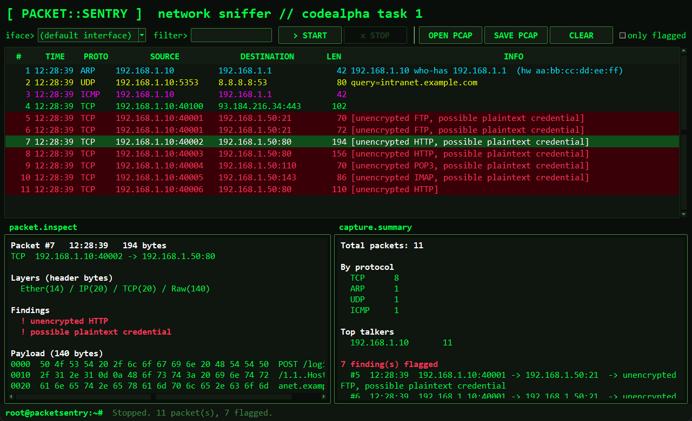

# PacketSentry

A basic network packet sniffer — **CodeAlpha Cyber Security Internship, Task 1**.

Captures live traffic and shows source/destination IPs, ports, protocol and a
payload preview for each packet. It also flags the two things a sniffer is
most useful for spotting on a network: **plaintext credentials** crossing the
wire, and traffic on protocols that were **never encrypted to begin with**
(HTTP, FTP, Telnet, POP3, IMAP). The goal isn't just to dump packets — it's to
show *why* visibility into raw traffic matters from a defensive standpoint.

## What it does

- Captures live packets with `scapy`.
- Parses ARP, TCP, UDP, ICMP and DNS queries.
- Shows each packet's layer structure on request (`Ether(14) / IP(20) /
  TCP(20) / Raw(64)` - every layer and the bytes its header takes up), to see
  how protocols are stacked inside a single frame.
- Prints a one-line summary per packet: timestamp, protocol, source/destination
  IP and port, and (optionally) a printable preview of the payload.
- Flags unencrypted-protocol traffic and anything that looks like a plaintext
  credential: form fields (`password=...`), FTP/POP3 `USER`/`PASS`, IMAP
  `LOGIN` and HTTP Basic `Authorization` headers.
- Prints an end-of-capture summary: packet counts by protocol, top talkers,
  and every flagged finding in one place.
- Can save the capture to a `.pcap` file, and read one back (`-r`) for
  offline analysis - which needs no admin rights.

## Usage

```
pip install -r requirements.txt

python packet_sentry.py                      # sniff on the default interface
python packet_sentry.py --list-interfaces     # show interface names
python packet_sentry.py -i "Wi-Fi" -c 200     # capture 200 packets on Wi-Fi
python packet_sentry.py -f "tcp port 80"      # only HTTP traffic (BPF filter)
python packet_sentry.py -p                    # show payload previews too
python packet_sentry.py -w capture.pcap       # also save to a pcap file
python packet_sentry.py -r capture.pcap -v -p  # analyse a saved capture
python packet_sentry.py -v                    # show each packet's layer structure
```

## Desktop GUI

```
python packet_sentry_gui.py
```



A Wireshark-style window with a terminal / hacker theme (black background,
neon-green monospace text), built with Tkinter (ships with Python, nothing extra
to install), using the same capture and detection code as the CLI:

- Interface picker, BPF filter box, **Start / Stop** live capture.
- Live packet table coloured by protocol; flagged packets are highlighted red.
- **Only flagged** toggle to cut straight to the findings.
- Packet detail pane: layer structure, findings, a hex/ASCII payload dump and
  every decoded field.
- Running capture summary: protocol counts, top talkers, flagged findings.
- **Open pcap... / Save pcap...** - opening a saved capture needs no admin
  rights, so it's the easiest way to try it out.

Live capture still needs the GUI to be launched from an Administrator / root
terminal.

## Try it in 30 seconds (no admin needed)

`make_demo_pcap.py` writes a small, fully synthetic capture - made-up
addresses and credentials over FTP, HTTP, POP3 and IMAP, plus clean DNS,
ICMP, ARP and HTTPS traffic - so you can see every detection fire without
running a server or sniffing anyone's real traffic:

```
python make_demo_pcap.py                     # writes demo.pcap
python packet_sentry.py -r demo.pcap -v -p   # CLI
python packet_sentry_gui.py                  # GUI -> OPEN PCAP -> demo.pcap
```

## Files

| File | What it is |
|------|------------|
| `packet_sentry.py` | Capture + analysis engine and command-line interface |
| `packet_sentry_gui.py` | Tkinter desktop GUI on top of the same engine |
| `make_demo_pcap.py` | Generates a synthetic `demo.pcap` for testing / demos |

## Sample output (CLI)

```
PacketSentry - reading capture.pcap
12:12:41 ARP   192.168.1.10 who-has 192.168.1.1  (hw aa:bb:cc:dd:ee:ff)
   Ether(14) / ARP(28)
12:12:41 UDP   192.168.1.10:5353 -> 8.8.8.8:53  query=example.com
   Ether(14) / IP(20) / UDP(8) / DNS(29)
12:12:41 TCP   192.168.1.10:40000 -> 192.168.1.50:21 [unencrypted FTP, possible plaintext credential]
   Ether(14) / IP(20) / TCP(20) / Raw(14)
   PASS hunter2..
12:12:41 TCP   192.168.1.10:40001 -> 192.168.1.50:80 [unencrypted HTTP, possible plaintext credential]
   Ether(14) / IP(20) / TCP(20) / Raw(64)
   POST /login HTTP/1.1..Host: s....username=jay&password=secret123

============================================================
Capture summary
============================================================
Total packets: 4

By protocol:
   TCP      2
   ARP      1
   UDP      1

Top talkers:
   192.168.1.10       4 packet(s)

2 finding(s) flagged:
   12:12:41  192.168.1.10:40000 -> 192.168.1.50:21  -> unencrypted FTP, possible plaintext credential
   12:12:41  192.168.1.10:40001 -> 192.168.1.50:80  -> unencrypted HTTP, possible plaintext credential
```

Live capture needs **Administrator / root** to open a raw socket (reading a
saved `.pcap` with `-r` does not). On Windows you also need
[Npcap](https://npcap.com) installed (tick "WinPcap API-compatible mode"
during setup) — plain `pip install scapy` is not enough on its own.

## Why it's built this way

- **Flags instead of just dumps.** Two thousand lines of raw packets tells
  you nothing by itself. Marking plaintext credentials and unencrypted
  protocols turns the output into something you'd actually act on.
- **A summary, not just a stream.** The end-of-run report (protocol
  breakdown, top talkers, flagged findings) is what you'd actually hand to
  someone — the live scroll is for watching, the summary is for reporting.
- **Fails loudly, not silently.** If scapy or Npcap is missing, or the
  process isn't elevated, it says exactly what's missing and how to fix it,
  rather than capturing nothing and giving no output.

## Disclaimer

Educational project, built for the CodeAlpha Cyber Security Internship.
**Only run this on a network you own or are authorised to monitor.**
Capturing traffic you don't have permission to see may be illegal where you
live.
